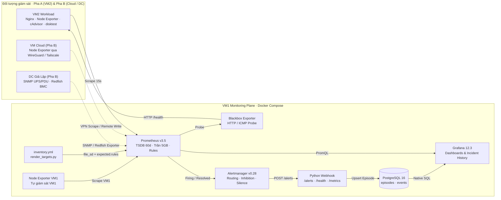

<div align="center">
  

  <br/><br/>

  <a href="https://github.com/HuynhHa17/Moni-Prototype/actions/workflows/ci.yml">
    
  </a>
  
  
  
  
  

  <p>
    <a href="#live-demo">Live Demo</a> &nbsp;·&nbsp;
    <a href="#kiến-trúc-hệ-thống">Kiến trúc</a> &nbsp;·&nbsp;
    <a href="#chiến-lược-cảnh-báo-4-tầng">Cảnh báo 4 tầng</a> &nbsp;·&nbsp;
    <a href="#triển-khai-nhanh">Triển khai nhanh</a> &nbsp;·&nbsp;
    <a href="#kịch-bản-kiểm-thử-sự-cố">Kịch bản lỗi</a> &nbsp;·&nbsp;
    <a href="#lộ-trình-triển-khai">Lộ trình</a> &nbsp;·&nbsp;
    <a href="#tài-liệu-kỹ-thuật">Tài liệu</a>
  </p>
</div>

---

**Moni-Prototype** là nền tảng giám sát hạ tầng đa lớp (máy chủ Linux, container, Cloud và trung tâm dữ liệu) kết hợp cảnh báo chuẩn SRE.  
Hệ thống tách bạch hoàn toàn mặt phẳng giám sát (`VM1`) khỏi đối tượng gây lỗi (`VM2`, `VM Cloud`, `DC giả lập`), áp dụng nghiêm nguyên tắc **`no-data ≠ healthy`** trên mọi biểu thức PromQL và bảng Grafana, lưu vòng đời sự cố nguyên tử vào **PostgreSQL 16**, và tự động kiểm chứng qua GitHub Actions CI (`unittest`, `promtool`, `amtool`, `docker compose config`).

---

## Live Demo

<div align="center">
  
</div>

### Điểm truy cập dịch vụ (Lab Runtime)

| Thành phần | Địa chỉ mặc định | Phạm vi truy cập | Vai trò |
| :--- | :--- | :--- | :--- |
| **Grafana** | `http://<VM1_IP>:3000` | Mạng lab *(HTTPS tại SEC-01)* | Dashboard `Host Overview v6` & native PostgreSQL datasource |
| **Prometheus** | `http://<VM1_IP>:9090` | Mạng lab / `127.0.0.1` | Scrape 15s, `file_sd` targets, recording/alert rules, TSDB `60d / 5GB` |
| **Alertmanager** | `http://127.0.0.1:9093` | Chỉ nội bộ `VM1` | Gom nhóm, định tuyến, repeat, silence và ức chế bão cảnh báo |
| **Webhook Receiver** | `http://webhook:8080` | Nội bộ Docker `VM1` | `POST /alerts`, `GET /health`, `GET /metrics` (Prometheus tự scrape) |
| **PostgreSQL 16** | `postgres:5432` | Nội bộ Docker `VM1` | Lưu bảng `episodes` & `events` với khóa hàng `FOR UPDATE` |
| **Workload Probe** | `http://<VM2_IP>:8080/health` | Mạng lab | Endpoint kiểm tra tính sẵn sàng từ Blackbox Exporter |

> [!TIP]
> **Mở Live Demo tạm thời khi review / bảo vệ (không cần mở port router):**
> ```bash
> cloudflared tunnel --url http://127.0.0.1:3000
> ```

---

## Kiến trúc hệ thống



### Bảo đảm kỹ thuật cốt lõi

| Nguyên tắc | Cách hiện thực trong repo |
| :--- | :--- |
| **Mất dữ liệu là Chưa xác định, không phải Khỏe** | Mọi rule tài nguyên và probe bắt buộc `up == 1`; mất dữ liệu hiển thị `CHƯA XÁC ĐỊNH` (`vector(-1)`) và kích hoạt `ExporterDown`, `ProbeScrapeFailed` hoặc `TargetMissing`. |
| **Tách bạch Inventory & Secret** | `inventory.yml` và `.env` được gitignore; `scripts/render_targets.py` ghi nguyên tử `file_sd` kèm bộ nhãn chuẩn (`environment`, `site`, `rack`, `team`, `host`, `target_id`) và không lọt IP vào `expected.rules.yml`. |
| **Vòng đời sự cố không trùng lặp** | Khóa định danh `(fingerprint, starts_at)` trong PostgreSQL 16 (`schema_pg.sql`), tách riêng thời gian nguồn (`startsAt`/`endsAt`) với thời gian nhận (`first_received_at`/`last_received_at`). |
| **Giám sát chính hệ thống giám sát** | `VM1` tự chạy `node-exporter` (`host="monitoring-vm1"`), scrape `alertmanager:9093` và `webhook:8080/metrics`, áp trần `mem_limit`/`cpus` và cảnh báo lỗi reload, rule evaluation, notification và TSDB cap. |

---

## Chiến lược cảnh báo 4 tầng

Toàn bộ rule đều đi kèm kiểm thử `promtool test rules` và hướng dẫn xử lý tương ứng tại [docs/alerts.md](docs/alerts.md):

| Tầng | Phạm vi | Danh sách Rule (Đã chạy & Kế hoạch) |
| :--- | :--- | :--- |
| **1. Lỗi cứng & Ngưỡng tĩnh** | Sự cố tức thời / bão hòa tài nguyên | `ServiceHttpDown` (`critical`), `HostHighCpu`, `HostHighMemory`, `FilesystemAlmostFull`, `FilesystemInodesAlmostFull` |
| **2. Mất dữ liệu & Self-Health** | Ngăn lỗi chết trong im lặng | `ExporterDown`, `ProbeScrapeFailed`, `TargetMissing` *(khớp theo `job, host, target_id`)*, `PrometheusConfigReloadFailed`, `PrometheusRuleEvaluationFailures`, `AlertmanagerNotificationFailed`, `PrometheusTSDBNearCap` |
| **3. Triệu chứng dịch vụ (M2b)** | Chất lượng trải nghiệm người dùng | `ServiceSloFastBurn` & `ServiceSloSlowBurn` (đa cửa sổ + low-traffic guard), `ContainerDown`, `ContainerHighMemory` |
| **4. Dự báo cạn kiệt (M3a)** | Cảnh báo trước khi đầy đĩa | `FilesystemWillFillIn4h` / `In24h` dùng `predict_linear` 4-guard |

---

## Triển khai nhanh

### 1. Cấu hình trên `VM1` (Monitoring)

```bash
git clone https://github.com/HuynhHa17/Moni-Prototype.git
cd Moni-Prototype

cp .env.example .env
cp inventory.example.yml inventory.yml
```

Điền IP máy `VM2` và mật khẩu Grafana/PostgreSQL vào `.env` và `inventory.yml`, sau đó sinh danh sách target:

```bash
python3 scripts/render_targets.py --inventory-file inventory.yml
```

*(Vẫn tương thích ngược với chế độ `.env`: `python3 scripts/render_targets.py --env-file .env`.)*

### 2. Khởi chạy stack `VM2` (Workload) và `VM1` (Monitoring)

```bash
# Trên VM2 (Workload)
docker compose --env-file .env -f workload/compose.yaml up -d

# Trên VM1 (Monitoring)
docker compose --env-file .env -f monitoring/compose.yaml up -d
```

### 3. Kiểm tra sức khỏe & truy vấn lịch sử sự cố

```bash
# Kiểm tra sẵn sàng Webhook & kết nối PostgreSQL 16
docker compose -f monitoring/compose.yaml exec webhook \
  python -c "import urllib.request; print(urllib.request.urlopen('http://127.0.0.1:8080/health').read().decode())"

# Xem danh sách sự cố (định dạng giờ UTC+7)
docker compose -f monitoring/compose.yaml exec webhook python history.py episodes --limit 10

# Xuất CSV giữ nguyên UTC để đối chiếu và tính MTTD / MTTR
docker compose -f monitoring/compose.yaml exec webhook python history.py export episodes
```

---

## Kịch bản kiểm thử sự cố

<details>
<summary><strong>Sự cố dịch vụ HTTP — <code>ServiceHttpDown</code> (Critical · for: 1m)</strong></summary>

```bash
# Gây lỗi trên VM2
docker compose -f workload/compose.yaml stop nginx

# Khôi phục trên VM2
docker compose -f workload/compose.yaml start nginx
```
Xác minh `probe_success == 0` với `up{job="http"} == 1` → mở `episode` mới trong PostgreSQL và tự chuyển `resolved` kèm thời lượng khi bật lại.

</details>

<details>
<summary><strong>Tải CPU cao kéo dài — <code>HostHighCpu</code> (Warning · for: 3m)</strong></summary>

```bash
# Gây tải trên VM2 (tự dừng sau 240 giây)
stress-ng --cpu "$(nproc)" --timeout 240s
```
Xác minh trung bình 2 phút vượt 85% liên tục 3 phút bắn `HostHighCpu`, đồng thời các gai tải ngắn 30 giây không gây báo giả.

</details>

<details>
<summary><strong>Đầy phân vùng cô lập — <code>FilesystemAlmostFull</code> (Warning · for: 2m)</strong></summary>

```bash
# Chạy trên phân vùng loopback 256 MiB riêng biệt tại VM2 (không chạm đĩa gốc /)
sudo bash workload/scripts/disktest.sh setup
sudo bash workload/scripts/disktest.sh fill 95

# Dọn sạch và xác minh tự động resolved
sudo bash workload/scripts/disktest.sh clean
```

</details>

<details>
<summary><strong>Bộ kiểm chứng tự động (Unit Tests · promtool · amtool)</strong></summary>

```bash
# 65 Python unit tests (inventory, alert runbooks, dashboard v6, webhook, CLI)
python3 -m unittest discover -s tests -v
python3 -m unittest discover -s monitoring/webhook/tests -v

# Kiểm thử cú pháp và kịch bản PromQL bằng promtool
docker run --rm --entrypoint promtool \
  -v "$PWD/monitoring/prometheus:/etc/prometheus:ro" \
  prom/prometheus:v3.5.0 test rules /etc/prometheus/tests/*.test.yml

# Kiểm tra cú pháp cấu hình Alertmanager
docker run --rm --entrypoint amtool \
  -v "$PWD/monitoring/alertmanager:/etc/alertmanager:ro" \
  prom/alertmanager:v0.28.1 check-config /etc/alertmanager/alertmanager.yml
```

</details>

---

## Lộ trình triển khai

Hoàn thiện trọn vẹn phần lõi trên 2 VM (**Pha A**) trước khi mở rộng sang Cloud và DC giả lập (**Pha B**):

| Mốc | Phạm vi | Hạn chốt | Trạng thái | Đầu ra chính |
| :--- | :--- | :---: | :---: | :--- |
| **M0 – M1** | Nền tảng & 3 ca E2E lõi | `2026-11-25` | Hoàn thành | `TC-SVC`, `TC-CPU`, `TC-DSK`, `HIS-09`, `cAdvisor`, `Host Overview v6` |
| **M2a** | Nâng cấp nền Production | `2026-12-04` | Hoàn thành | ADR-04, `inventory.yml`, PostgreSQL 16, VM1 self-monitoring, CI gate |
| **M2b** | Lớp dịch vụ & 4 Dashboard | `2026-12-11` | Tiếp theo | `podinfo` + phát tải nền, SLO Burn Rate, Container alerts, 4 Dashboards |
| **M3a** | Dự báo Disk & Reachability | `2026-12-18` | Kế hoạch | `disktest drip/burst`, `predict_linear` 4-guard, `HostDown` |
| **M3b** | Alertmanager NOC & Lịch sử | `2026-12-25` | Kế hoạch | Telegram Critical/Warning, Inhibition, Watchdog, Dashboard Lịch sử |
| **M4a** | Pha B: Cloud & DC giả lập | `2027-01-01` | Kế hoạch | `VM Cloud` (VPN + Heartbeat ngoài VM1), `DC Sim` (SNMP + Redfish) |
| **M4b** | Fault Harness & Báo cáo KPI | `2027-01-08` | Kế hoạch | Feature Freeze, bộ đo Positive/Negative KPI, chốt ngưỡng `BSL-01` |
| **M5** | Hardening & Bàn giao | `2027-01-15` | Kế hoạch | `SEC-01` (TLS/UFW), Backup/Restore `pg_dump`, dựng lại sạch `HND-02` |

---

## Tài liệu kỹ thuật

| Tài liệu | Nội dung |
| :--- | :--- |
| [docs/architecture.md](docs/architecture.md) | Topo hệ thống, luồng pull/alert và ranh giới mạng |
| [docs/architecture-decision.md](docs/architecture-decision.md) | Hồ sơ quyết định kiến trúc (`ADR-01` → `ADR-04`) |
| [docs/alerts.md](docs/alerts.md) | Danh mục cảnh báo đầy đủ và Runbook xử lý cho người trực |
| [docs/setup.md](docs/setup.md) | Hướng dẫn cài đặt từng bước trên VM1 và VM2 |
| [docs/project-plan.md](docs/project-plan.md) | Kế hoạch theo mốc, phụ thuộc và nguyên tắc thu gọn rủi ro |
| [docs/requirements.md](docs/requirements.md) | Ma trận yêu cầu chức năng và phi chức năng |
| [docs/validation.md](docs/validation.md) | Nhật ký bằng chứng xác minh trên lab thực tế |
| [docs/acceptance-tests.md](docs/acceptance-tests.md) | Bộ tiêu chí và kịch bản kiểm thử nghiệm thu |
