<div align="center">
  

  <br/><br/>

  <a href="https://github.com/HuynhHa17/Moni-Prototype/actions/workflows/ci.yml">
    
  </a>
  
  
  
  
  

  <p>
    <a href="#live-demo">Live Demo</a> &nbsp;·&nbsp;
    <a href="#chiến-lược-cảnh-báo-4-tầng">Cảnh báo 4 tầng</a> &nbsp;·&nbsp;
    <a href="#triển-khai-nhanh">Triển khai nhanh</a> &nbsp;·&nbsp;
    <a href="#kịch-bản-kiểm-thử-sự-cố">Kịch bản lỗi</a>
  </p>
</div>

---

**Moni-Prototype** là nền tảng giám sát hạ tầng đa lớp (máy chủ Linux, container, Cloud và trung tâm dữ liệu) kết hợp cảnh báo chuẩn SRE.  
Hệ thống tách bạch hoàn toàn mặt phẳng giám sát (`VM1`) khỏi đối tượng gây lỗi (`VM2`, `VM Cloud`, `DC giả lập`), áp dụng nghiêm nguyên tắc **`no-data ≠ healthy`** trên mọi biểu thức PromQL và bảng Grafana, lưu vòng đời sự cố nguyên tử vào **PostgreSQL 16**, và tự động kiểm chứng qua GitHub Actions CI (`unittest`, `promtool`, `amtool`, `docker compose config`).

---

## Live Demo

<div align="center">
  
</div>

### Điểm truy cập dịch vụ (Lab Runtime)

| Thành phần | Địa chỉ mặc định | Phạm vi truy cập | Vai trò |
| :--- | :--- | :--- | :--- |
| **Grafana** | `http://<VM1_IP>:3000` | Mạng lab *(HTTPS tại SEC-01)* | Dashboard `Host Overview v6` & native PostgreSQL datasource |
| **Prometheus** | `http://<VM1_IP>:9090` | Mạng lab / `127.0.0.1` | Scrape 15s, `file_sd` targets, recording/alert rules, TSDB `60d / 5GB` |
| **Alertmanager** | `http://127.0.0.1:9093` | Chỉ nội bộ `VM1` | Gom nhóm, định tuyến, repeat, silence và ức chế bão cảnh báo |
| **Webhook Receiver** | `http://webhook:8080` | Nội bộ Docker `VM1` | `POST /alerts`, `GET /health`, `GET /metrics` (Prometheus tự scrape) |
| **PostgreSQL 16** | `postgres:5432` | Nội bộ Docker `VM1` | Lưu bảng `episodes` & `events` với khóa hàng `FOR UPDATE` |
| **Workload Probe** | `http://<VM2_IP>:8080/health` | Mạng lab | Endpoint kiểm tra tính sẵn sàng từ Blackbox Exporter |

> [!TIP]
> **Mở Live Demo tạm thời khi review / bảo vệ (không cần mở port router):**
> ```bash
> cloudflared tunnel --url http://127.0.0.1:3000
> ```

---

## Chiến lược cảnh báo 4 tầng

Toàn bộ rule đều đi kèm kiểm thử `promtool test rules` và hướng dẫn xử lý tương ứng tại [docs/alerts.md](docs/alerts.md):

| Tầng | Phạm vi | Danh sách Rule (Đã chạy & Kế hoạch) |
| :--- | :--- | :--- |
| **1. Lỗi cứng & Ngưỡng tĩnh** | Sự cố tức thời / bão hòa tài nguyên | `ServiceHttpDown` (`critical`), `HostHighCpu`, `HostHighMemory`, `FilesystemAlmostFull`, `FilesystemInodesAlmostFull` |
| **2. Mất dữ liệu & Self-Health** | Ngăn lỗi chết trong im lặng | `ExporterDown`, `ProbeScrapeFailed`, `TargetMissing` *(khớp theo `job, host, target_id`)*, `PrometheusConfigReloadFailed`, `PrometheusRuleEvaluationFailures`, `AlertmanagerNotificationFailed`, `PrometheusTSDBNearCap` |
| **3. Triệu chứng dịch vụ (M2b)** | Chất lượng trải nghiệm người dùng | `ServiceSloFastBurn` & `ServiceSloSlowBurn` (đa cửa sổ + low-traffic guard), `ContainerDown`, `ContainerHighMemory` |
| **4. Dự báo cạn kiệt (M3a)** | Cảnh báo trước khi đầy đĩa | `FilesystemWillFillIn4h` / `In24h` dùng `predict_linear` 4-guard |

---

## Triển khai nhanh

### 1. Cấu hình trên `VM1` (Monitoring)

```bash
git clone https://github.com/HuynhHa17/Moni-Prototype.git
cd Moni-Prototype

cp .env.example .env
cp inventory.example.yml inventory.yml
```

Điền IP máy `VM2` và mật khẩu Grafana/PostgreSQL vào `.env` và `inventory.yml`, sau đó sinh danh sách target:

```bash
python3 scripts/render_targets.py --inventory-file inventory.yml
```

*(Vẫn tương thích ngược với chế độ `.env`: `python3 scripts/render_targets.py --env-file .env`.)*

### 2. Khởi chạy stack `VM2` (Workload) và `VM1` (Monitoring)

```bash
# Trên VM2 (Workload)
docker compose --env-file .env -f workload/compose.yaml up -d

# Trên VM1 (Monitoring)
docker compose --env-file .env -f monitoring/compose.yaml up -d
```

### 3. Kiểm tra sức khỏe & truy vấn lịch sử sự cố

```bash
# Kiểm tra sẵn sàng Webhook & kết nối PostgreSQL 16
docker compose -f monitoring/compose.yaml exec webhook \
  python -c "import urllib.request; print(urllib.request.urlopen('http://127.0.0.1:8080/health').read().decode())"

# Xem danh sách sự cố (định dạng giờ UTC+7)
docker compose -f monitoring/compose.yaml exec webhook python history.py episodes --limit 10

# Xuất CSV giữ nguyên UTC để đối chiếu và tính MTTD / MTTR
docker compose -f monitoring/compose.yaml exec webhook python history.py export episodes
```

---

## Kịch bản kiểm thử sự cố

<details>
<summary><strong>Sự cố dịch vụ HTTP — <code>ServiceHttpDown</code> (Critical · for: 1m)</strong></summary>

```bash
# Gây lỗi trên VM2
docker compose -f workload/compose.yaml stop nginx

# Khôi phục trên VM2
docker compose -f workload/compose.yaml start nginx
```
Xác minh `probe_success == 0` với `up{job="http"} == 1` → mở `episode` mới trong PostgreSQL và tự chuyển `resolved` kèm thời lượng khi bật lại.

</details>

<details>
<summary><strong>Tải CPU cao kéo dài — <code>HostHighCpu</code> (Warning · for: 3m)</strong></summary>

```bash
# Gây tải trên VM2 (tự dừng sau 240 giây)
stress-ng --cpu "$(nproc)" --timeout 240s
```
Xác minh trung bình 2 phút vượt 85% liên tục 3 phút bắn `HostHighCpu`, đồng thời các gai tải ngắn 30 giây không gây báo giả.

</details>

<details>
<summary><strong>Đầy phân vùng cô lập — <code>FilesystemAlmostFull</code> (Warning · for: 2m)</strong></summary>

```bash
# Chạy trên phân vùng loopback 256 MiB riêng biệt tại VM2 (không chạm đĩa gốc /)
sudo bash workload/scripts/disktest.sh setup
sudo bash workload/scripts/disktest.sh fill 95

# Dọn sạch và xác minh tự động resolved
sudo bash workload/scripts/disktest.sh clean
```

</details>

<details>
<summary><strong>Bộ kiểm chứng tự động (Unit Tests · promtool · amtool)</strong></summary>

```bash
# 65 Python unit tests (inventory, alert runbooks, dashboard v6, webhook, CLI)
python3 -m unittest discover -s tests -v
python3 -m unittest discover -s monitoring/webhook/tests -v

# Kiểm thử cú pháp và kịch bản PromQL bằng promtool
docker run --rm --entrypoint promtool \
  -v "$PWD/monitoring/prometheus:/etc/prometheus:ro" \
  prom/prometheus:v3.5.0 test rules /etc/prometheus/tests/*.test.yml

# Kiểm tra cú pháp cấu hình Alertmanager
docker run --rm --entrypoint amtool \
  -v "$PWD/monitoring/alertmanager:/etc/alertmanager:ro" \
  prom/alertmanager:v0.28.1 check-config /etc/alertmanager/alertmanager.yml
```

</details>
