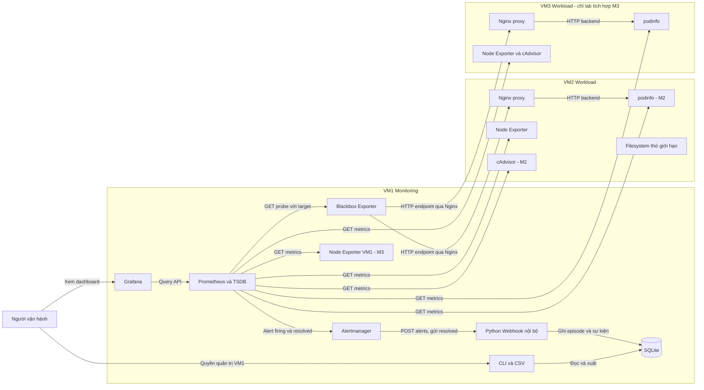

# Kiến trúc và luồng dữ liệu

Đây là **thiết kế đích** theo bản điều chỉnh 12/11/2026. Tài liệu validation
ghi thành phần thực sự có trong cấu hình. M1 thêm cảnh báo/lịch sử, M2 thêm
cAdvisor/podinfo, M3 thêm VM3/quan sát VM1/reachability/dự báo. Chưa coi các
khối đó là đang chạy. Bộ 5 sơ đồ `.drawio`/SVG do DES-01–05 tiếp tục thực hiện.

Mũi tên metrics/probe/query là **chiều request**; response metric/result trả
ngược lại, Prometheus chủ động pull. Exporter không tự push metric sang TSDB.
Alert và lịch sử là luồng riêng, không dùng SQLite để thay TSDB.

## Ranh giới lab và mạng

- Cá nhân chỉ có VM1/VM2. VM3 không bắt buộc cho thành viên dựng lại phần lõi.
- VM2/VM3 dùng cùng workload Compose và .env riêng; VM1 render toàn bộ inventory.
- Docker DNS như `prometheus`, `blackbox`, backend podinfo chỉ trong network
  cùng host; kết nối giữa VM dùng IP và cổng lab, không dùng tên service Compose.
- Cấu hình hiện tại: HTTP workload 8080, Node Exporter 9100, Grafana 3000,
  Prometheus 9090; .env có thể đổi cổng publish. Backend/cAdvisor/Alertmanager
  sẽ khai báo cổng chính xác khi thêm, không coi cổng dự kiến là đang mở.
- Prometheus/Grafana dùng named volume; SQLite/Alertmanager sẽ có volume tại
  task tương ứng. Webhook/SQLite không publish; Viewer không có CLI lịch sử.
- Filesystem thử nằm trên workload host, dung lượng giới hạn, xác minh mount
  và Node Exporter thấy đúng trước ghi. Mount lỗi phải dừng, không ghi thư mục nền.

## Diễn giải tín hiệu

| Quan sát | Kết luận có căn cứ |
| --- | --- |
| HTTP probe=0, up của probe=1, node up=1 | HTTP không đạt từ VM1; host metrics vẫn thu được |
| HTTP probe=1, node up=0 | Endpoint đạt, mất quan sát tài nguyên host |
| Probe scrape=0 hoặc target mất | Chưa xác định endpoint, không suy healthy |
| Nhiều đường đều mất | Kiểm tra VM/mạng, cần tín hiệu reachability trước quy HostDown |
| Container Up nhưng ứng dụng lỗi | Trạng thái tiến trình chưa chứng minh chức năng dịch vụ |
| Alert hết firing vì mất metric | Chưa chứng minh phục hồi, cần phép kiểm tra mới |

Các rule ức chế ở M3 phải thử nguồn/đích cùng host và cả lỗi độc lập host khác.
VM1 không thể tự báo độc lập khi chính nó hoặc laptop ngừng hoạt động.
