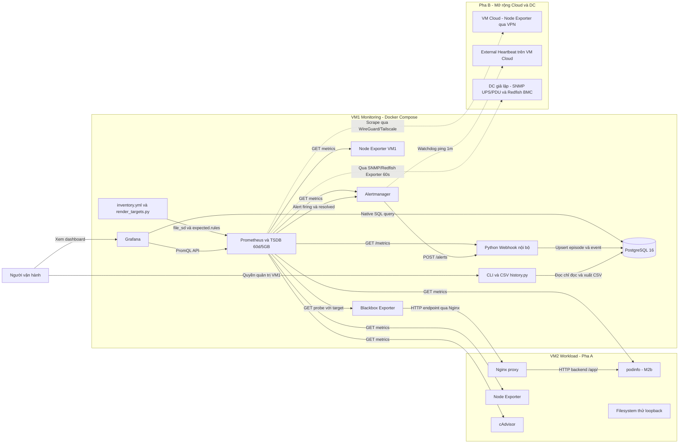

# Kiến trúc và luồng dữ liệu

Tài liệu cập nhật theo **ADR-04 (28/11/2026)**: hoàn thiện trọn vẹn **Pha A** trên 2 máy ảo cục bộ (`VM1 Monitoring` + `VM2 Workload`) trước, sau đó mở rộng sang **Pha B** (`VM Cloud` qua VPN + `External Heartbeat` ngoài miền lỗi và `DC giả lập` SNMP/Redfish). Thành phần đã triển khai thực tế trên nhánh `main` gồm: Prometheus (`60d / 5GB`), Blackbox, Node Exporter tự giám sát `VM1`, Alertmanager, Python Webhook (`/alerts`, `/health`, `/metrics`), **PostgreSQL 16**, Grafana (`Host Overview v6` + native PostgreSQL datasource), Nginx, Node Exporter `VM2`, cAdvisor và `disktest.sh`.

Mũi tên nét liền là luồng **Pha A**, nét đứt (`-.->`) là luồng **Pha B**. Với metrics/probe/query, chiều mũi tên biểu diễn **chiều gửi request** (Prometheus chủ động pull, exporter không tự push vào TSDB). Luồng cảnh báo và lịch sử đi riêng sang PostgreSQL 16, không dùng CSDL quan hệ để thay TSDB.

## Ranh giới lab và mạng

- **Pha A (mặc định cá nhân & nhóm):** chỉ cần `VM1` (Monitoring) và `VM2` (Workload). Đã bỏ mô hình `VM3` cục bộ cũ theo ADR-04.3.
- **Inventory & Secret tách biệt:** `inventory.yml` và `.env` đều nằm trong `.gitignore`. `scripts/render_targets.py` đọc `inventory.yml` (hoặc `.env` tương thích ngược) để sinh nguyên tử `file_sd` JSON kèm bộ nhãn chuẩn (`environment`, `site`, `rack`, `team`, `host`, `target_id`) và `expected.rules.yml` không chứa địa chỉ IP.
- **Docker DNS vs IP mạng lab:** Tên service như `prometheus`, `blackbox`, `postgres`, `webhook`, `node-exporter` chỉ phân giải bên trong Docker network của cùng một VM; kết nối từ `VM1` sang `VM2` luôn đi qua IP thực của lab khai báo trong `inventory.yml` / `.env`.
- **Cổng mạng hiện tại:**
  - Trên `VM1`: Grafana `3000`, Prometheus `9090` (sẽ giới hạn loopback/TLS tại `SEC-01`), Alertmanager `127.0.0.1:9093` (chỉ nội bộ `VM1`). `postgres`, `webhook` và `node-exporter` của `VM1` **không publish cổng** ra ngoài host.
  - Trên `VM2`: Nginx HTTP `8080`, Node Exporter `9100`, cAdvisor `8081` (và `podinfo` `9898` khi triển khai `M2b` — nếu bật `ufw` trên `VM2`, chỉ mở các cổng exporter cho IP của `VM1`).
- **Lưu trữ bền vững:** `prometheus-data`, `grafana-data`, `alertmanager-data`, `postgres-data` dùng Docker named volume; sao lưu PostgreSQL thực hiện bằng `pg_dump`, không copy trực tiếp thư mục dữ liệu sống.
- **Filesystem thử nghiệm:** `workload/scripts/disktest.sh` tạo phân vùng loopback 256 MiB riêng tại `/mnt/moni-disktest`; kiểm tra mount hợp lệ trước khi ghi để tuyệt đối không làm đầy phân vùng gốc `/`.

## Diễn giải tín hiệu

| Quan sát | Kết luận có căn cứ |
| --- | --- |
| HTTP probe=0, `up` của probe=1, `node up`=1 | Endpoint HTTP không đạt từ `VM1`; tài nguyên host vẫn thu thập được |
| HTTP probe=1, `node up`=0 | Endpoint HTTP vẫn đạt, nhưng mất quan sát tài nguyên host (`ExporterDown`) |
| Probe scrape=0 hoặc mất target khỏi `file_sd` | Trạng thái endpoint là **chưa xác định**, tuyệt đối không suy healthy |
| Nhiều đường cùng mất tới một host | Cần tín hiệu reachability độc lập (`HST-01`) trước khi kết luận `HostDown` |
| Container Up nhưng `/app/healthz` hoặc 5xx lỗi | Tiến trình container chạy chưa chứng minh dịch vụ backend hoạt động đúng |
| Alert hết firing do mất series metric | Chưa chứng minh dịch vụ đã phục hồi; cần phép đo mới với `up = 1` |

Các luật ức chế (`INH-01`) chỉ áp dụng trong cùng phạm vi nhãn (`site`, `rack`, `host`, `environment`), phải kiểm thử cả 2 chiều để không che khuất lỗi độc lập ở host khác. Vì `VM1` không thể tự gửi cảnh báo khi chính nó hoặc máy vật lý chứa `VM1` tắt, dịch vụ `External Heartbeat` ở Pha B được đặt trên `VM Cloud` thuộc miền lỗi vật lý độc lập.
